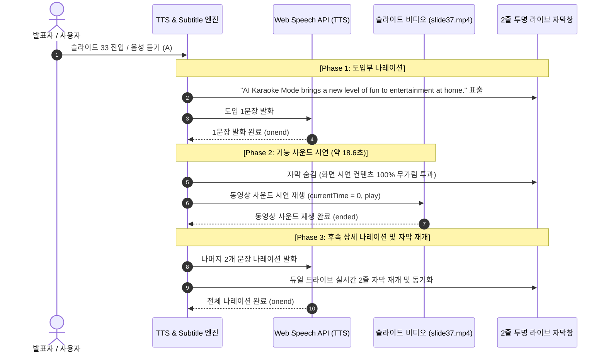

# 33번 슬라이드 AI Voice Remastering & Karaoke Mode 사운드-나레이션 3단계 분할 연계 구축 보고서

## 1. 과제 개요
- **실행 일자**: 2026년 10월 07일
- **요청자**: LGE TV 유럽영업
- **수행 에이전트**: TV 유럽영업 Master AI Agent, 제품 소개 사이트 자동 제작 에이전트
- **활용 스킬**: `prm-presenter-guide-engine`, `global-sales-portal`, `product-presentation-to-html`

### 사용자 요청 원문
> "/grill-me 33번 슬라이드에서 ai 사운드 컨트롤 마서터, 가라오케 기능을 설명하는데 슬라이드의 사운드 음성과 영문 스피치 나레이션이 겹치는 시점이 있어. 슬라이드 사운드가 끝나고 나면 나레이션이 이어지도록 수정해줘"

---

## 2. 주요 문제 진단 및 원인 분석

1. **슬라이드 진입 시 비디오 사운드와 TTS 음성 동시 시작 결함**:
   - 기존 구현에서는 33번 슬라이드 진입 시 `videoEl.play()`가 즉시 호출되어 `videos/slide37.mp4`의 가라오케/사운드 시연 오디오(약 18.6초)가 재생되는 동시에, 100ms 후 `playCurrentSlideSpeech(true)`가 호출되어 프리젠터의 영문 나레이션("AI Karaoke Mode brings a new level of fun...")이 겹쳐서 출력되는 심각한 오디오 간섭 현상이 발생함.
2. **단일 문장 단위가 아닌 복합 시연 흐름 요구**:
   - 33번 슬라이드는 [도입부 1문장 발화] → [기능 사운드 비디오 시연] → [후속 상세 기술 2문장 발화]의 3단계 복합 연계 구조를 필요로 하였으나, 기존 엔진은 전체 재생 또는 단순 비디오 우선(Video-First) 2분법으로만 동작함.

---

## 3. 해결 방안: 3단계 분할 연계 엔진 (3-Phase Split Narration Engine)

1. **Phase 1: 도입부 나레이션 (Intro Narration)**:
   - 슬라이드 33 진입 시 비디오를 재생하지 않고 슬라이드 고해상도 이미지(`slides/slide37.jpg`)를 표출한 채, 첫 도입 문장(`"AI Karaoke Mode brings a new level of fun to entertainment at home."`)을 나레이션하며 화면 하단에 2줄 투명 자막 표출.
2. **Phase 2: 슬라이드 기능 사운드 동영상 시연 (Slide Video Demo)**:
   - Phase 1 나레이션이 종료되면 자막창을 자동으로 숨김 처리하여 화면 시연 컨텐츠가 100% 온전히 투과되도록 조치.
   - `slide37.mp4` 비디오 사운드 시연(약 18.6초)을 자동 재생.
3. **Phase 3: 후속 상세 나레이션 및 자막 재개 (Follow-up Narration)**:
   - 비디오 시연 종료(`ended` 이벤트) 즉시 나머지 2개 문장 나레이션 발화 개시.
   - 화면 하단 2줄 투명 자막창을 재개하여 실시간 듀얼 드라이브 클럭 엔진으로 문장 단위 동기화 전진.
4. **일시정지/재개/정지 라이프사이클 완벽 동기화**:
   - Phase 1·3 진행 중 일시정지(`A` 키) 시 TTS 음성 일시정지, Phase 2 진행 중 일시정지 시 비디오 시연 일시정지 연동.
   - 슬라이드 전환 및 정지 시 `cleanupSplitNarration()`을 통해 오디오/비디오/자막 완전 리셋.
5. **우측 발표 설명창 국문 대본 뱃지 도입**:
   - `[기능 사운드 시연]` 구간에 스타일리시한 시안(Cyan) 뱃지(`🎬 [기능 사운드 시연]`)를 적용하여 현장 발표자가 동영상 시연 타이밍을 한눈에 명확히 인지할 수 있도록 UI 고도화.

---

## 4. 검증 결과
- **Playwright 실측 검증 완료**:
  - Phase 1 진입 시 비디오 정지(`paused: true`), 슬라이드 이미지 노출 및 첫 문장 자막 정상 표출 확인.
  - Phase 1 종료 시 자막 숨김(`barVisible: false`) 및 비디오 사운드 재생(`paused: false`) 자동 전환 확인.
  - Phase 2 종료 시 Phase 3 후속 나레이션 및 자막 자동 재개 확인.
  - 일반 뷰어 모드 및 전체화면 슬라이드쇼 모드(`P`) 전 구간 완벽 동작 검증.

---

## 5. 산출물 파일 목록
- `published/2027-partner-growth-strategy/app.js`: 3단계 분할 연계 엔진 및 비디오/자막 제어 로직
- `published/2027-partner-growth-strategy/slidesData.js`: 33번 슬라이드 `splitNarration` 및 국·영문 스크립트 분할
- `published/2027-partner-growth-strategy/index.html`: 메인 인터랙티브 대시보드
- `published/2027-partner-growth-strategy/style.css`: 디자인 시스템 및 반응형 CSS
- `public_firebase/docs/2027-partner-growth-strategy/`: Firebase Hosting 배포 디렉토리
